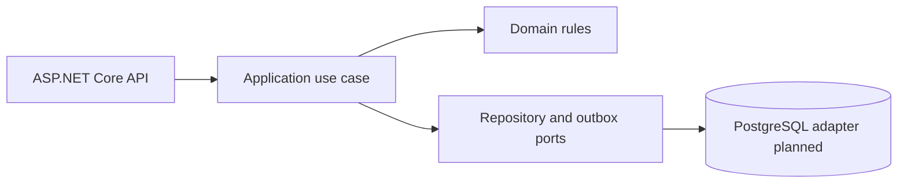

# .NET Modernization Blueprint

A compact .NET 8 API reference for modernizing a legacy workflow into a modular, observable service. It demonstrates a thin HTTP boundary, application use case, domain validation, idempotency contract, health probes, and an outbox persistence boundary.

## Architecture

## Included

- Minimal API endpoints with request validation and health checks.
- Domain model and application service separated from transport concerns.
- Idempotency key contract to make retries safe.
- Transactional outbox message written atomically with the work item in the in-memory adapter; a durable dispatcher/database adapter is the next extension.
- Container build and local Postgres service for the next adapter increment.

## Run

Requires the .NET 8 SDK. From this directory run `dotnet run --project src/Modernization.Api`. The in-memory repository is explicitly a demo adapter; the SQL/outbox adapter is an extension point. Run `dotnet test tests/Modernization.Api.Tests/Modernization.Api.Tests.csproj` to execute the unit tests.

## Design notes

The portfolio shows the transition path from a tightly coupled legacy endpoint to a service with clear module boundaries, compatibility-minded API contracts, safe retries, and operational health endpoints. It does not claim production deployment or measured outcomes for this sample.
